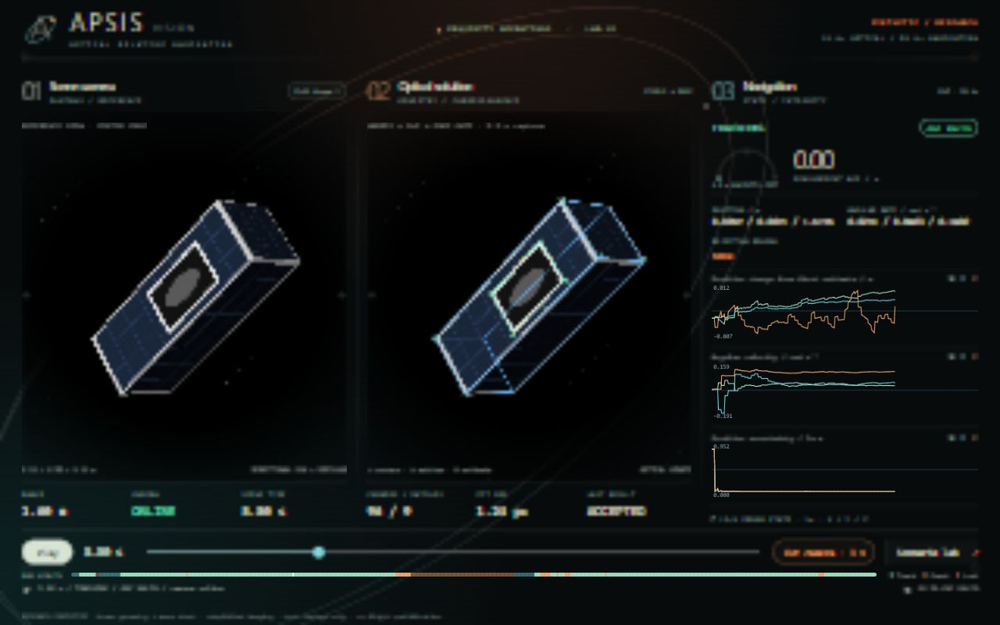
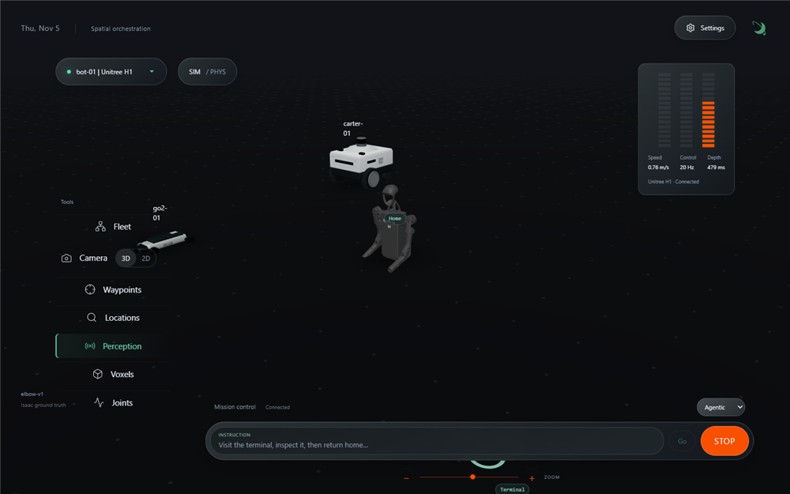
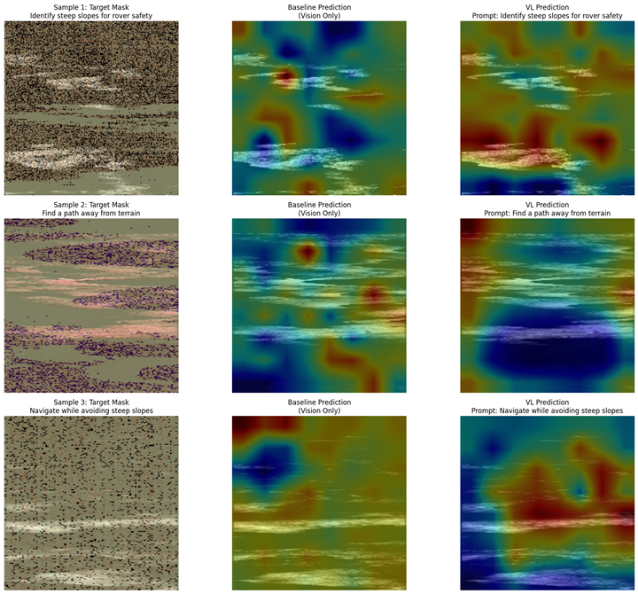

<div align="center">

# Hi, I'm Riley Marek 👋

### Product Engineer & Founder
**Building products that improve lives, ground technology in physical reality, and engineer a hopeful future.**

<p align="center">
  <a href="https://github.com/RileyMarek"></a>
  <a href="mailto:riley.marek@wsu.edu"></a>
  
  
</p>

---

</div>

### 💡 Areas of Interest & Focus

* **Autonomous Systems** — Resilient edge computing, real-time architectures, and mission-critical autonomy engineered for high-assurance, constrained environments.
* **Embodied AI & Robotics** — Bringing physical intelligence into the real world through physics-first simulation (Isaac Sim), real-time digital twins, and closed-loop control.
* **Space GNC** — Vision models with deterministic safety guarantees for flight navigation, rendezvous, proximity operations, and orbital docking (RPOD).
* **Foundation Models & Tasteful AI Products** — Building where user experience and genuine utility come first: *good product design = best solution > AI solution*.

---

### 🚀 Featured Products & Flagship Systems

<table>
  <tr>
    <td width="50%" valign="top">
      <h3 align="center"><a href="https://github.com/RileyMarek/ApsisVision">🛰️ Apsis Vision</a></h3>
      <p align="center"><b>Autonomous Relative Spacecraft Navigation in Rust</b></p>
      <div align="center">
        <a href="https://github.com/RileyMarek/ApsisVision">
          
        </a>
      </div>
      <p>Satellite servicing, orbital refueling, and debris removal currently stall because visual docking in space is plagued by brutal solar glare, specular reflections, and zero GPS reference. Apsis Vision provides an allocation-free, deterministic <code>no_std</code> Rust relative optical navigation core that tracks uncooperative and cooperative tumbling targets with verified 6-DoF state estimation, enabling spacecraft to approach and dock safely without human intervention.</p>
      <p align="center">
        <code>Rust</code> · <code>no_std</code> · <code>Orbital GNC</code> · <code>EKF</code> · <code>Computer Vision</code> · <code>Space Autonomy</code>
      </p>
    </td>
    <td width="50%" valign="top">
      <h3 align="center"><a href="https://github.com/RileyMarek/Moonbase-Orchestrator-Public-Showcase-">🤖 Moonbase</a></h3>
      <p align="center"><b>Embodied Robotics Command Center & VLA Execution</b></p>
      <div align="center">
        <a href="https://github.com/RileyMarek/Moonbase-Orchestrator-Public-Showcase-">
          
        </a>
      </div>
      <p>Operating heterogeneous robot fleets (humanoids, quadrupeds, wheeled AMRs) is bottlenecked by fragmented tooling, high-latency teleoperation, and a disconnect between high-level AI reasoning and physical joint control. Moonbase unifies fleet orchestration into a high-performance spatial command center—pairing browser-based WebGL/Three.js digital twins and ROS 2 FastDDS telemetry with multimodal Vision-Language-Action (VLA) spatial intelligence for real-time mission execution.</p>
      <p align="center">
        <code>Python</code> · <code>ROS 2</code> · <code>Isaac Sim</code> · <code>FastDDS</code> · <code>Three.js</code> · <code>VLAs</code> · <code>Physical AI</code>
      </p>
    </td>
  </tr>
  <tr>
    <td width="50%" valign="top">
      <h3 align="center"><a href="https://github.com/RileyMarek/NasaRoverVLModel">🪐 NASA Rover VL Model</a></h3>
      <p align="center"><b>Planetary Surface Autonomy & Vision-Language Navigation</b></p>
      <div align="center">
        <a href="https://github.com/RileyMarek/NasaRoverVLModel">
          
        </a>
      </div>
      <p>Planetary rovers on the Moon and Mars face minutes-long communication latency with Earth, making manual hazard avoidance slow and high-risk. This autonomous system integrates vision-language multimodal reasoning (CLIP + U-Net with FiLM adaptation) directly into surface navigation, enabling rovers to autonomously parse natural terrain hazards, assess traversability, and plan safe traversal paths across unstructured planetary environments.</p>
      <p align="center">
        <code>Python</code> · <code>PyTorch</code> · <code>U-Net</code> · <code>Vision-Language</code> · <code>CLIP</code> · <code>Autonomous Navigation</code>
      </p>
    </td>
    <td width="50%" valign="top">
      <h3 align="center">🧠 ADAPT-AI <small><i>(Proprietary)</i></small></h3>
      <p align="center"><b>Multi-Agent LLM Platform for Educational Assessment</b></p>
      <p>Designing valid, multidimensional cognitive and educational assessments is traditionally an exhausting, months-long manual process for academic research labs. ADAPT-AI replaces this friction with an automated multi-agent LLM platform developed for the CAIRE Research Lab, orchestrating deterministic multi-stage evaluation pipelines with real-time streaming and cryptographically auditable PostgreSQL persistence to generate verified assessment items in minutes.</p>
      <p align="center">
        <code>FastAPI</code> · <code>Agentic Workflows</code> · <code>PostgreSQL</code> · <code>Next.js</code> · <code>Docker</code> · <code>Human-Centric AI</code>
      </p>
    </td>
  </tr>
</table>

---

### 🛠️ Core Craft & Engineering Stack

<div align="center">

| Domain | Technologies & Systems |
| :--- | :--- |
| **Languages** |     |
| **Robotics & Space Systems** |      |
| **AI, Perception & Compute** |      |
| **Distributed Product Infra** |      |

</div>

---

### 📈 Activity & Momentum

<div align="center">


<br/>


</div>

---

<div align="center">

```
"The future belongs to those who build it with purpose, precision, and boundless optimism."
```

<sub>Crafted with conviction. Shipping products that push humanity forward.</sub>

</div>
