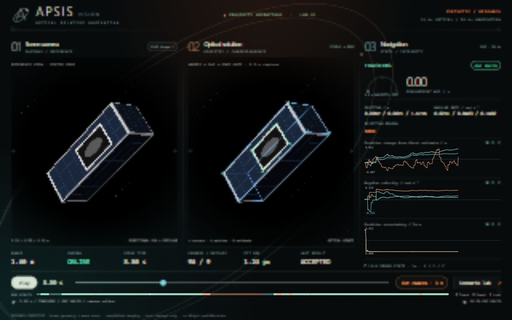

<div align="center">

# Hi, I'm Riley Marek 👋

[](https://git.io/typing-svg)

<p align="center">
  <b>Product Engineer & Founder building the physical and digital frontiers of human progress — from autonomous space navigation and intelligent embodied robotics to human-centered AI products that improve real lives.</b>
</p>

<p align="center">
  <a href="https://github.com/RileyMarek"></a>
  <a href="mailto:riley.marek@wsu.edu"></a>
  
  
  
</p>

<p align="center">
  
</p>

---

</div>

### 🚀 What I Build & Why

> *"The best way to predict the future is to build it with conviction."*

I believe technology reaches its highest purpose when it expands human potential, opens new frontiers, and solves real, grounded problems:
* **The High Frontier:** Autonomous optical navigation and GNC engines that make sustainable orbital logistics, space exploration, and planetary missions viable.
* **Embodied Physical AI:** Grounding foundation models in physical reality through physics-first robotics, real-time digital twins, and assistive physical autonomy.
* **Intelligent Human Products:** Transforming complex multi-agent intelligence into accessible, reliable tools that empower researchers, clinicians, and learners.

---

### 🛰️ Featured Ventures & Flagship Systems

<table>
  <tr>
    <td width="50%" valign="top">
      <h3 align="center"><a href="https://github.com/RileyMarek/ApsisVision">🛰️ Apsis Vision</a></h3>
      <p align="center"><b>Autonomous Relative Spacecraft Navigation in Rust</b></p>
      <div align="center">
        <a href="https://github.com/RileyMarek/ApsisVision">
          
        </a>
      </div>
      <p>An allocation-free, deterministic optical navigation core enabling spacecraft to safely rendezvous, inspect, and dock in orbit without human intervention:</p>
      <ul>
        <li><b>Flight-Ready Core:</b> Strict <code>no_std</code>, zero-allocation 12-state EKF cross-compiled for ARM Cortex-M/R and embedded Linux.</li>
        <li><b>Robust Perception:</b> Dual-stage visual admission, geometric 6x6 covariance estimation, and latched ambiguity holds under harsh solar glare.</li>
        <li><b>Orbital Dynamics:</b> Closed-loop Hill-Clohessy-Wiltshire (HCW) relative dynamics with approach corridors, virtual capture, and automated aborts.</li>
      </ul>
      <p align="center">
        <code>Rust</code> · <code>no_std</code> · <code>Orbital GNC</code> · <code>Computer Vision</code> · <code>EKF</code> · <code>Space Autonomy</code>
      </p>
    </td>
    <td width="50%" valign="top">
      <h3 align="center">🤖 Moonbase</h3>
      <p align="center"><b>Embodied Robotics Command Center & VLA Execution</b></p>
      <p>A unified robotics operations and physical-intelligence platform connecting high-level foundation models with low-level deterministic control:</p>
      <ul>
        <li><b>Physics & Simulation:</b> High-fidelity Isaac Sim (NVIDIA Omniverse) with native RTX physics for rapid sim-to-real transfer.</li>
        <li><b>Real-Time Telemetry:</b> Low-latency ROS 2, FastDDS, and Foxglove WebSocket streaming bridging distributed edge compute.</li>
        <li><b>Foundation Robotics:</b> Remote Vision-Language-Action (Molmo-7B) integration with a live Three.js / React 3D digital twin.</li>
      </ul>
      <p align="center">
        <code>Python</code> · <code>ROS 2</code> · <code>Isaac Sim</code> · <code>FastDDS</code> · <code>Three.js</code> · <code>VLAs</code> · <code>Physical AI</code>
      </p>
    </td>
  </tr>
  <tr>
    <td width="50%" valign="top">
      <h3 align="center">🪐 NASA Rover Autonomy</h3>
      <p align="center"><b>Planetary Surface Robotics & Exploration Navigation</b></p>
      <p>Autonomous navigation, hazard avoidance, and state estimation architecture built for planetary surface exploration:</p>
      <ul>
        <li><b>Multi-Sensor Fusion:</b> Deterministic state estimation fusing IMU, GNSS, wheel odometry, and stereo depth.</li>
        <li><b>Hazard & Terrain Mapping:</b> Real-time traversability evaluation, dynamic obstacle avoidance, and local path planning.</li>
        <li><b>Harsh Telemetry Comms:</b> High-integrity CAN bus and resilient UDP/Ethernet communication pipelines for mission-critical telemetry.</li>
      </ul>
      <p align="center">
        <code>C++</code> · <code>ROS 2</code> · <code>Sensor Fusion</code> · <code>Path Planning</code> · <code>CAN Bus</code> · <code>Planetary Robotics</code>
      </p>
    </td>
    <td width="50%" valign="top">
      <h3 align="center">🧠 ADAPT-AI <small><i>(Proprietary)</i></small></h3>
      <p align="center"><b>Multi-Agent LLM Platform for Educational Assessment</b></p>
      <p>High-impact human-centric AI application developed for the CAIRE Research Lab at Washington State University:</p>
      <ul>
        <li><b>Multi-Stage Cognitive Pipelines:</b> Deterministic P1–P6 sequential and conditional prompt orchestration architectures.</li>
        <li><b>Resilient Async Backend:</b> Distributed FastAPI service architecture with real-time session streaming and robust telemetry.</li>
        <li><b>Mission-Critical Persistence:</b> Enterprise PostgreSQL schema with cryptographic audit trails and schema migrations.</li>
      </ul>
      <p align="center">
        <code>FastAPI</code> · <code>Agentic Workflows</code> · <code>PostgreSQL</code> · <code>Next.js</code> · <code>Docker</code> · <code>AI for Education</code>
      </p>
    </td>
  </tr>
  <tr>
    <td width="50%" valign="top">
      <h3 align="center">🔬 Geometric Perception & Edge Intelligence</h3>
      <p align="center"><b>Vision Systems Grounded in Physical Reality</b></p>
      <p>Bridging deep neural perception with mathematically rigorous geometric state estimation for edge hardware:</p>
      <ul>
        <li><b>6-DoF Landmark Tracking:</b> Heatmap regression for 3D landmarks paired with EPnP RANSAC and Levenberg-Marquardt refinement.</li>
        <li><b>Extreme Domain Adaptation:</b> Training vision models to conquer extreme radiometry gaps (space specular glare, Earth albedo, shadows).</li>
        <li><b>Algorithmic Integrity:</b> Analytic covariance propagation, Mahalanobis outlier gating, and spatial entropy confidence screening.</li>
      </ul>
      <p align="center">
        <code>PyTorch</code> · <code>Computer Vision</code> · <code>EPnP / RANSAC</code> · <code>ONNX Runtime</code> · <code>Edge AI</code>
      </p>
    </td>
    <td width="50%" valign="top">
      <h3 align="center">⚡ High-Throughput Distributed Systems</h3>
      <p align="center"><b>Ultra-Low Latency Telemetry & Inter-Process Comms</b></p>
      <p>Mission-critical networking infrastructure powering real-time physical systems and distributed inference:</p>
      <ul>
        <li><b>Real-Time IPC:</b> Zero-copy message passing with FastDDS and high-speed streaming protocols optimized for sub-millisecond control.</li>
        <li><b>Distributed Cluster Bridge:</b> Multi-node compute orchestration with bounded-queue replay buffers and automated QoS throttling.</li>
        <li><b>Hardware Abstraction:</b> Clean boundaries between mathematical algorithms and target execution hardware.</li>
      </ul>
      <p align="center">
        <code>FastDDS</code> · <code>WebSockets</code> · <code>gRPC</code> · <code>FastAPI</code> · <code>Distributed Systems</code> · <code>Linux</code>
      </p>
    </td>
  </tr>
</table>

---

### 🛠️ Core Craft & Engineering Stack

<div align="center">

| Domain | Technologies & Systems |
| :--- | :--- |
| **Languages** |     |
| **Robotics & Space Systems** |      |
| **AI, Perception & Compute** |      |
| **Distributed Product Infra** |      |

</div>

---

### 📈 Activity & Momentum

<div align="center">


<br/>


</div>

---

<div align="center">

```
"The future belongs to those who build it with purpose, precision, and boundless optimism."
```

<sub>Crafted with conviction. Shipping products that push humanity forward.</sub>

</div>
